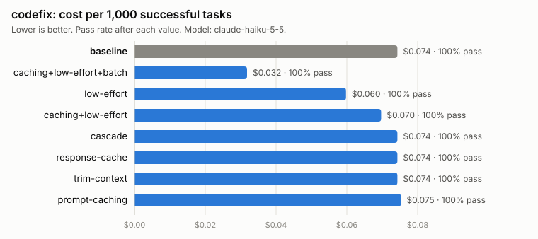
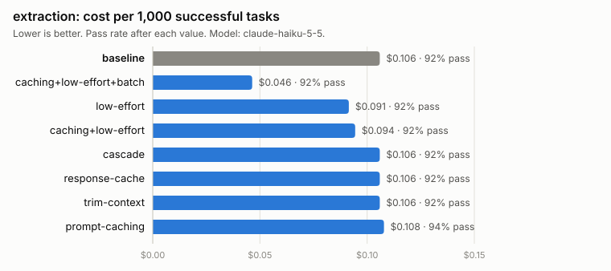
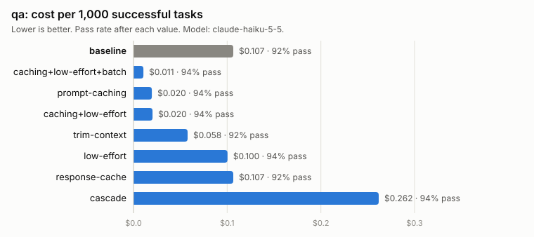

# Results

_Generated by `python -m costlab report` on 2026-11-04 from `results/results.sqlite`. Do not edit by hand: change `results/notes.md` or re-run the report._

## Headline

**`caching+low-effort+batch` cut cost per successful task by 70.4%** against a claude-haiku-5-5 baseline, across all 130 tasks, without losing a single task on any workload.

- **It waits for results.** The Batch API answers asynchronously: about 6 min here, up to 24 hours by the API's terms.
- **About 31 of those 70 points are the Batch API's 50% list-price discount** (`batch_multiplier` in `prices.yaml`), not measured token savings. The same strategy without batch: -38.9%.
- **Best without the batch wait:** `caching+low-effort`, -38.9%.
- **qa drives 52% of the money saved.** A different mix of workloads would move the headline; see each workload below.
- **Repeated 2 more times** with fresh calls for both this strategy and the baseline: the cut ranged from 70.4% to 71.0%. See Repeatability below.

## All workloads together

Pooled over every workload: total cost divided by total successful tasks. "Quality held" means no workload lost more than 1 point (one task is 2 points on qa and extraction, 3.3 on codefix, so in practice: no task lost).

| Strategy | Tasks | Passed | Total cost | Cost per 1k successes | vs baseline | Quality held |
| --- | ---: | ---: | ---: | ---: | ---: | --- |
| `baseline` | 130 | 122 | $0.011999 | $0.098 | - | - |
| `caching+low-effort+batch` | 130 | 123 | $0.003583 | $0.029 | -70.4% | yes |
| `caching+low-effort` | 130 | 123 | $0.007389 | $0.060 | -38.9% | yes |
| `prompt-caching` | 130 | 124 | $0.008245 | $0.066 | -32.4% | yes |
| `trim-context` | 130 | 122 | $0.009756 | $0.080 | -18.7% | yes |
| `low-effort` | 130 | 123 | $0.010718 | $0.087 | -11.4% | yes |
| `response-cache` | 130 | 122 | $0.011999 | $0.098 | = baseline (replayed) | - |
| `cascade` | 130 | 123 | $0.019401 | $0.158 | +60.4% | yes |

## codefix

Baseline: 30 tasks, 100.0% pass, $0.074 per 1,000 successful tasks.
Best with quality held: **`caching+low-effort+batch`**, -57.2% cost per success, +0.0 pts.
Best without the batch wait: **`low-effort`**, -19.5%, +0.0 pts.

<picture>
  <source media="(prefers-color-scheme: dark)" srcset="charts/codefix-dark.svg">
  
</picture>

| Strategy | Pass rate | Quality vs baseline | Total cost | Cost per 1k successes | vs baseline | Median latency |
| --- | ---: | ---: | ---: | ---: | ---: | ---: |
| `baseline` | 100.0% | - | $0.002229 | $0.074 | - | 1.17 s |
| `caching+low-effort+batch` | 100.0% | +0.0 pts | $0.000954 | $0.032 | -57.2% | 6 min |
| `low-effort` | 100.0% | +0.0 pts | $0.001793 | $0.060 | -19.5% | 1.18 s |
| `caching+low-effort` | 100.0% | +0.0 pts | $0.002091 | $0.070 | -6.2% | 1.19 s |
| `prompt-caching` | 100.0% | +0.0 pts | $0.002259 | $0.075 | +1.3% | 1.22 s |
| `cascade` | 100.0% | = baseline (replayed) | $0.002229 | $0.074 | = baseline (replayed) | 1.17 s |
| `response-cache` | 100.0% | = baseline (replayed) | $0.002229 | $0.074 | = baseline (replayed) | 1.17 s |
| `trim-context` | 100.0% | = baseline (replayed) | $0.002229 | $0.074 | = baseline (replayed) | 1.17 s |

## extraction

Baseline: 50 tasks, 92.0% pass, $0.106 per 1,000 successful tasks.
Best with quality held: **`caching+low-effort+batch`**, -56.2% cost per success, +0.0 pts.
Best without the batch wait: **`low-effort`**, -13.6%, +0.0 pts.

<picture>
  <source media="(prefers-color-scheme: dark)" srcset="charts/extraction-dark.svg">
  
</picture>

| Strategy | Pass rate | Quality vs baseline | Total cost | Cost per 1k successes | vs baseline | Median latency |
| --- | ---: | ---: | ---: | ---: | ---: | ---: |
| `baseline` | 92.0% | - | $0.004871 | $0.106 | - | 1.30 s |
| `caching+low-effort+batch` | 92.0% | +0.0 pts | $0.002133 | $0.046 | -56.2% | 6 min |
| `low-effort` | 92.0% | +0.0 pts | $0.004207 | $0.091 | -13.6% | 1.17 s |
| `caching+low-effort` | 92.0% | +0.0 pts | $0.004344 | $0.094 | -10.8% | 1.16 s |
| `prompt-caching` | 94.0% | +2.0 pts | $0.005068 | $0.108 | +1.8% | 1.30 s |
| `cascade` | 92.0% | = baseline (replayed) | $0.004871 | $0.106 | = baseline (replayed) | 1.30 s |
| `response-cache` | 92.0% | = baseline (replayed) | $0.004871 | $0.106 | = baseline (replayed) | 1.30 s |
| `trim-context` | 92.0% | = baseline (replayed) | $0.004871 | $0.106 | = baseline (replayed) | 1.30 s |

## qa

Baseline: 50 tasks, 92.0% pass, $0.107 per 1,000 successful tasks.
Best with quality held: **`caching+low-effort+batch`**, -90.1% cost per success, +2.0 pts.
Best without the batch wait: **`prompt-caching`**, -81.7%, +2.0 pts.

<picture>
  <source media="(prefers-color-scheme: dark)" srcset="charts/qa-dark.svg">
  
</picture>

| Strategy | Pass rate | Quality vs baseline | Total cost | Cost per 1k successes | vs baseline | Median latency |
| --- | ---: | ---: | ---: | ---: | ---: | ---: |
| `baseline` | 92.0% | - | $0.004899 | $0.107 | - | 1.09 s |
| `caching+low-effort+batch` | 94.0% | +2.0 pts | $0.000496 | $0.011 | -90.1% | 6 min |
| `prompt-caching` | 94.0% | +2.0 pts | $0.000918 | $0.020 | -81.7% | 1.07 s |
| `caching+low-effort` | 94.0% | +2.0 pts | $0.000954 | $0.020 | -80.9% | 1.06 s |
| `trim-context` | 92.0% | +0.0 pts | $0.002657 | $0.058 | -45.8% | 1.09 s |
| `low-effort` | 94.0% | +2.0 pts | $0.004718 | $0.100 | -5.8% | 1.09 s |
| `cascade` | 94.0% | +2.0 pts | $0.012301 | $0.262 | +145.7% | 1.10 s |
| `response-cache` | 92.0% | = baseline (replayed) | $0.004899 | $0.107 | = baseline (replayed) | 1.09 s |

## Which model? (plain baseline, no optimizations)

Every model answers the same tasks with the baseline prompt. Compared with claude-haiku-5-5, the model all strategies above were measured on.

| Workload | Model | Pass rate | Quality vs claude-haiku-5-5 | Cost per 1k successes | Cost vs claude-haiku-5-5 |
| --- | --- | ---: | ---: | ---: | ---: |
| codefix | claude-haiku-5-5 | 100.0% | - | $0.074 | - |
| codefix | claude-opus-5-5 | 100.0% | +0.0 pts | $2.398 | 32.3x |
| codefix | claude-sonnet-5-5 | 100.0% | +0.0 pts | $0.997 | 13.4x |
| extraction | claude-haiku-5-5 | 92.0% | - | $0.106 | - |
| extraction | claude-opus-5-5 | 84.0% | -8.0 pts | $4.741 | 44.8x |
| extraction | claude-sonnet-5-5 | 86.0% | -6.0 pts | $1.995 | 18.8x |
| qa | claude-haiku-5-5 | 92.0% | - | $0.107 | - |
| qa | claude-opus-5-5 | 86.0% | -6.0 pts | $4.655 | 43.7x |
| qa | claude-sonnet-5-5 | 84.0% | -8.0 pts | $2.238 | 21.0x |

All 3 workloads pooled (total cost / total successful tasks):

- `claude-haiku-5-5`: 122/130 passed (93.8%), $0.098 per 1k successes.
- `claude-opus-5-5`: 115/130 passed (88.5%), $4.098 per 1k successes, 41.7x the cost per success of claude-haiku-5-5.
- `claude-sonnet-5-5`: 115/130 passed (88.5%), $1.823 per 1k successes, 18.5x the cost per success of claude-haiku-5-5.

## Repeatability (quality gate 4)

Each repeat is a fresh run of the same strategy on the same tasks (`costlab run --repeat-tag`), so the model answers again instead of replaying. Gate 4 asks cost per success to agree within 5% across runs. Ranges include the run reported above.

| Workload | Strategy | Runs | Pass rate | Cost per 1k successes | Spread | Within 5% |
| --- | --- | ---: | ---: | ---: | ---: | --- |
| codefix | `baseline` | 3 | 100% | $0.074 - $0.079 | 6.2% | **no** |
| codefix | `caching+low-effort+batch` | 3 | 100% | $0.030 - $0.032 | 5.5% | **no** |
| extraction | `baseline` | 3 | 92-96% | $0.100 - $0.106 | 5.6% | **no** |
| extraction | `caching+low-effort+batch` | 3 | 92% | $0.045 - $0.046 | 3.4% | yes |
| qa | `baseline` | 3 | 92-94% | $0.100 - $0.107 | 6.5% | **no** |
| qa | `caching+low-effort+batch` | 3 | 94-96% | $0.010 - $0.011 | 8.8% | **no** |

Change vs baseline, all workloads pooled, with each repeat paired against the baseline's repeat of the same tag:

- `caching+low-effort+batch`: reported run -70.4%; repeat1 -70.9%, repeat2 -71.0%.

## What didn't work (from the data)

Measured runs that cost the same or more than the baseline, or lost more than 1 point of quality:

- `prompt-caching` on codefix: +1.3% cost per success, +0.0 pts.
- `prompt-caching` on extraction: +1.8% cost per success, +2.0 pts.
- `cascade` on qa: +145.7% cost per success, +2.0 pts.

Not measured, identical to the baseline: on these workloads the strategy sent the baseline's exact requests (no escalation, nothing to trim, no repeated prompt), so its answers are the baseline's recorded ones:

- `cascade` on codefix
- `response-cache` on codefix
- `trim-context` on codefix
- `cascade` on extraction
- `response-cache` on extraction
- `trim-context` on extraction
- `response-cache` on qa

## Caveats (hand-written, `results/notes.md`)

- **Strategies were measured on the cheapest model.** Every strategy row uses Claude Haiku 5.5,
  which already passed 92-100%. That is also why the cascade could not win: escalating from the
  cheapest model can only add cost.
- **Bigger models scored lower here, and that is partly the grader.** Sonnet 5.5 and Opus 5.5
  (plain baselines, see "Which model?") matched Haiku on code fixes and fell 6-8 points behind
  on extraction and Q&A, at 18-42x the cost per success. Reading every failure: they "over-help".
  On extraction they compute due dates from payment terms where the answer key says the
  document gives none (Opus 5 times, Haiku 2), and invent a request label ("information") that
  is not one of the allowed values. On Q&A the facts were right but the answers carried
  qualifiers ("5 business days" for "5"), which the strict grader fails. So: for short,
  rule-bound tasks with exact answers, the cheapest model was the best choice; a looser grader
  would narrow the quality gap but not the 18-42x cost gap. These are single runs.
- **Small, self-written task sets.** 50 extraction tasks, 50 Q&A questions over two short
  fictional documents, 30 code fixes. One task is 2 points of pass rate (3.3 on code fixes).
- **Quality noise is about 2 points.** Strategies that send exactly the baseline's prompt text
  still moved by 2 points (one task).
- **Cost noise is large too.** On code fixes, `low-effort` and `caching+low-effort` send the same
  text (the shared prefix is too short to cache), yet they came out at -19.5% and -6.2%: about
  13 points apart, from run-to-run variation in how many output (thinking) tokens Haiku spends.
  Every strategy ran once, so treat single-digit differences on one workload as noise.
- **Half the headline is a price, not a measurement.** The Batch API's 50% comes from the price
  list (`batch_multiplier` in `prices.yaml`), applied to the measured tokens. It has not yet
  been checked against the Console bill.
- **Costs are computed, not billed.** Cost comes from stored token counts and `prices.yaml`
  (checked 2026-11-01). Replayed answers are priced as if they were paid, so each row shows what
  the run costs. Actual spend is in `memory/SPEND.md`.
- **The batch runs are stitched together.** In each workload the first 5 answers come from a
  separate 5-task smoke batch, the rest from the full batch. On Q&A that means two cache writes
  instead of one (slightly pessimistic). The 5 extraction smoke answers were recovered from a
  batch whose local process was killed for low memory; they record latency 0, which pulls the
  median latency down a little. Batch latency is the turnaround of the whole batch, not the time
  per answer.

## What didn't work, and why

- **Cascade (Haiku, then Sonnet when a check fails)** cost +145.7% per success on Q&A (+151%
  total cost) for a 2-point gain, which is inside the noise. It escalated 4 of 50 Q&A tasks and
  none elsewhere: the cheap model's answers mostly passed the prompt-only checks, including the
  wrong ones.
- **Prompt caching only helps long shared prefixes.** Claude Haiku 5.5 caches prefixes of 512
  tokens or more. Only the Q&A prompts (about 860 shared tokens) qualify; on extraction and code
  fixes it changed nothing.
- **Context trimming and caching cancel out.** Trimming cut Q&A prompts by ~45% (-46% cost), but
  a trimmed prompt falls under the caching minimum, and caching alone saved more (-81%). The
  retriever was also written by the same person as the questions, so its perfect document
  choice is optimistic.
- **Response cache saved nothing.** The benchmark never repeats a prompt, so every answer was the
  baseline's. Real savings depend on how often production traffic repeats.
- **Combining caching and low effort did not beat the single levers.** Each acts on a different
  workload. Combined, it was close to caching alone on Q&A (-80.5% vs -81.3%) but behind low
  effort alone on extraction (-10.8% vs -13.6%) and code fixes (-6.2% vs -19.5%), differences
  that are within the cost noise above. The large extra saving came from the Batch API, which
  only suits work that can wait.

## Quality gates

| Gate | Status |
| --- | --- |
| 1. Same tasks | Checked automatically: rows whose task-file hash differs from the baseline are left out. |
| 2. Grader sanity | Passed: tests check every grader passes the expected answers and fails wrong ones. |
| 3. Quality held | Per row above (no workload lost more than 1 point, i.e. no task). |
| 4. Repeatability | **Headline passed; single rows are noisy.** Re-measured twice with fresh calls on both sides, the pooled cut was -70.4%, -70.9%, -71.0% (within 0.6 points). Per workload, cost per success moved 3-9% between runs, and the unchanged baseline itself moved 5.6-6.5%: the plan's 5% per-row target is tighter than the model's own run-to-run noise, so single-workload differences under ~10% are not meaningful. |
| 5. Cost cross-check | **Not done yet** (compare the Console Cost page with `memory/SPEND.md`). |
| 6. No leakage | Prompts hold no answers (the cascade's check reads only the prompt); CI scans for API keys. |
